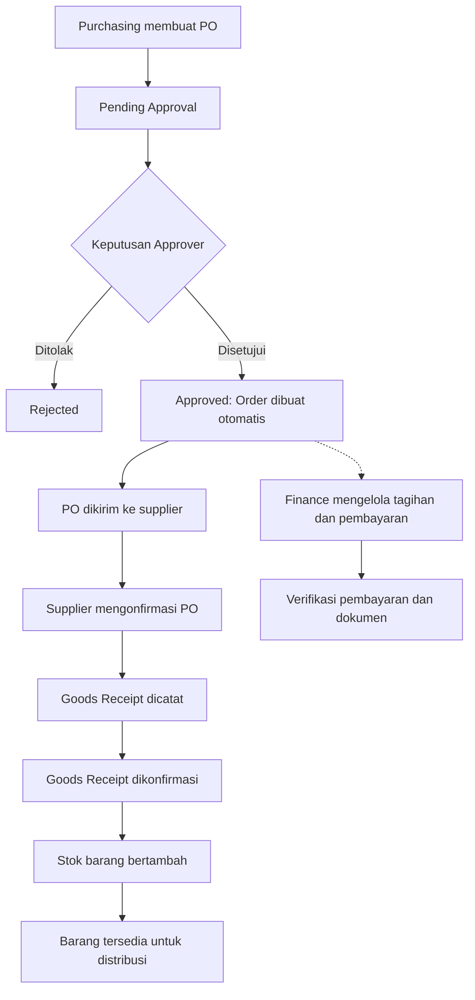
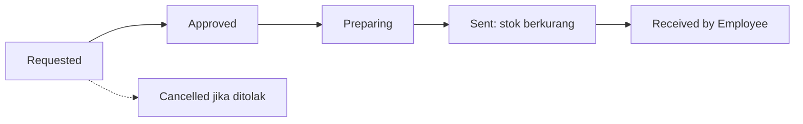

# Sistem Purchasing & Inventory

Aplikasi berbasis web untuk mengelola proses **pengadaan, penerimaan, pembayaran, persediaan, dan distribusi barang** dalam satu sistem terintegrasi. Dikembangkan menggunakan **Laravel** dan **MySQL** dengan pengaturan hak akses berdasarkan peran pengguna (*role-based access control*).

> **Referensi fungsional:** Buku Manual Pengguna Sistem Purchasing & Inventory, versi **1.0** — **3 November 2026**.
>
> Bagian fitur merangkum buku manual. Bagian Menjalankan Aplikasi menjelaskan integrasi Next.js dan Laravel yang tersedia di repositori.

## Daftar Isi

- [Sistem Purchasing \& Inventory](#sistem-purchasing--inventory)
  - [Daftar Isi](#daftar-isi)
  - [Fitur Utama](#fitur-utama)
  - [Teknologi](#teknologi)
  - [Peran dan Hak Akses](#peran-dan-hak-akses)
  - [Alur Proses Bisnis](#alur-proses-bisnis)
  - [Aturan dan Status Penting](#aturan-dan-status-penting)
    - [Purchase Order](#purchase-order)
    - [Goods Receipt](#goods-receipt)
    - [Payment dan Dokumen](#payment-dan-dokumen)
    - [Distribusi dan Inventory](#distribusi-dan-inventory)
  - [Menjalankan Aplikasi](#menjalankan-aplikasi)
  - [Panduan Penggunaan Singkat](#panduan-penggunaan-singkat)
  - [Pemecahan Masalah](#pemecahan-masalah)
  - [Dokumentasi dan Catatan Keamanan](#dokumentasi-dan-catatan-keamanan)

## Fitur Utama

| Modul | Fungsionalitas |
| --- | --- |
| **Dashboard** | Ringkasan PO, persetujuan, order, tagihan, penerimaan, distribusi, dokumen, dan stok menipis. |
| **Master Data** | Pengelolaan supplier, kategori, dan barang (SKU, satuan, stok minimum, harga terakhir). |
| **Purchase Order (PO)** | Membuat PO, pengajuan persetujuan, penolakan, pengiriman, dan konfirmasi supplier. |
| **Order Management** | Pemantauan order yang dibuat otomatis saat PO disetujui. |
| **Goods Receipt** | Pencatatan penerimaan bertahap, jumlah rusak, konfirmasi, dan penambahan stok. |
| **Payment** | Tagihan supplier, DP/cicilan/pelunasan, bukti pembayaran, serta verifikasi. |
| **Kuitansi & Dokumen** | Pengelolaan kuitansi, invoice, dan bukti bayar hingga verifikasi dokumen. |
| **Distribusi Karyawan** | Permintaan barang, persetujuan, persiapan, penyerahan, dan konfirmasi penerimaan. |
| **Inventory** | Pencarian stok, peringatan stok menipis, penyesuaian, dan riwayat mutasi. |
| **Pengguna & Role** | Pengaturan pengguna dan pembatasan menu serta tindakan berdasarkan peran. |

## Teknologi

- **Backend:** Laravel (PHP)
- **Database:** MySQL
- **Frontend:** Next.js (React dan TypeScript)

Lihat `backend/composer.json` dan `frontend/package.json` untuk persyaratan runtime.

## Peran dan Hak Akses

| Peran | Tanggung jawab utama |
| --- | --- |
| **Admin** | Seluruh modul serta pengelolaan pengguna dan role. |
| **Purchasing** | Supplier, pembuatan dan pengelolaan PO, Order Management, serta dukungan penerimaan dan distribusi. |
| **Approver / Manager** | Menyetujui atau menolak PO dan permintaan distribusi. |
| **Finance** | Mencatat dan memverifikasi pembayaran serta mengelola dokumen keuangan. |
| **Warehouse** | Penerimaan barang, kategori dan stok, mutasi, serta persiapan dan penyerahan distribusi. |
| **Employee** | Membuat permintaan barang dan mengonfirmasi penerimaan barang miliknya. |

Menu serta tindakan mengikuti role yang sedang login. Akses di luar kewenangan ditolak (**HTTP 403**).

## Alur Proses Bisnis



**Alur distribusi barang:**



## Aturan dan Status Penting

### Purchase Order

`Draft` → `Pending Approval` → `Approved` → `Sent` → `Received by Supplier`

Status alternatif: `Rejected` dan `Cancelled`.

- PO harus memiliki **minimal satu item**.
- PO hanya dapat **diubah saat Draft**.
- PO dapat **dihapus saat Draft, Rejected, atau Cancelled**, sesuai ketentuan manual.
- Saat PO **Approved**, sistem otomatis membuat data **Order**.
- Order dapat berstatus `pending`, `confirmed`, `partially received`, `completed`, atau `cancelled` sesuai progresnya.

### Goods Receipt

Status: `Pending`, `Fully Received`, `Partially Received`, `Discrepancy`.

- Penerimaan dibuat berdasarkan PO berstatus **Sent** atau **Received by Supplier**.
- Penerimaan awal berstatus **Pending** dan **belum** menambah stok.
- Stok bertambah **setelah Goods Receipt dikonfirmasi**.
- **Stok masuk = jumlah diterima − jumlah rusak**.
- Satu PO dapat diterima dalam beberapa tahap.

### Payment dan Dokumen

Status pembayaran: `Unpaid`, `Partially Paid`, `Pending Verification`, `Paid`, `Overdue`.

- Tagihan dapat dikaitkan dengan PO, tetapi relasi PO **opsional**.
- Pembayaran dapat berupa **DP, cicilan, atau pelunasan**.
- Pembayaran penuh harus **diverifikasi** sebelum berstatus `Paid`.

Status dokumen: `Not Uploaded` → `Uploaded` → `Sent` → `Received` → `Verified`.

### Distribusi dan Inventory

Status distribusi: `Requested` → `Approved` → `Preparing` → `Sent` → `Received by Employee`.

- Permintaan yang ditolak menjadi `Cancelled`.
- Stok **berkurang ketika distribusi berstatus Sent**, bukan saat permintaan dibuat.
- Penyerahan ditolak jika **stok tidak mencukupi**.
- Koreksi jumlah stok dilakukan melalui **Stock Adjustment** dengan alasan.
- Perubahan stok dari penerimaan, distribusi, dan penyesuaian tercatat di **Stock Movements**.
- Barang dianggap **stok menipis** jika `stok saat ini <= stok minimum`.

## Menjalankan Aplikasi

Jalankan Laravel dan Next.js dari dua terminal. Browser mengakses Next.js, lalu Next.js meneruskan permintaan ke Laravel. Login memakai akun Laravel dan sesi disimpan dalam cookie HttpOnly.

1. Di terminal backend, siapkan MySQL dan konfigurasi `backend/.env`. Untuk instalasi baru, salin `.env.example`, atur koneksi MySQL, lalu jalankan:

   ```sh
   cd backend
   composer install
   php artisan key:generate
   php artisan migrate
   php artisan db:seed
   php artisan serve --host=127.0.0.1 --port=8000
   ```

   Seeder meminta email, nama, dan kata sandi Super Admin. Tekan Enter pada pertanyaan email untuk melewati pembuatan akun dan memakai akun aktif yang sudah ada. Akun dengan role atau akun yang terhubung ke karyawan aktif dapat masuk.

2. Di terminal frontend:

   ```sh
   cd frontend
   npm ci
   npm run dev
   ```

   Buka [workspace lokal](http://localhost:3000). Bila alamat Laravel berbeda, set `LARAVEL_API_URL` di `frontend/.env.local` ke alamat server Laravel tanpa akhiran `/api/v1`. Bila Next.js berada di belakang reverse proxy, set `APP_ORIGIN` ke origin publik Next.js, misalnya `https://inventory.example.com`.

### Izin modul

Laravel memeriksa izin akun untuk setiap aksi. Seeder memasang izin modul saat menginisialisasi RBAC. Untuk role yang sudah dikonfigurasi, perubahan izin dilakukan lewat API RBAC.

### Cakupan integrasi

Dashboard, profil perusahaan/PT, supplier, kategori, barang, departemen, karyawan, jenis/tarif pajak, PO dan persetujuannya, order, penerimaan, distribusi, mutasi stok, tagihan, pembayaran, dokumen, pengguna, dan RBAC menggunakan Laravel. Jalankan `php artisan migrate` saat memperbarui aplikasi agar tabel dan izin modul baru tersedia.

PO menyimpan snapshot PT penerbit, alamat supplier, diskon, dan pajak per barang. Tambah dan edit memakai modal yang sama; hapus dan workflow tetap mengikuti status serta izin backend. Profil PT lama dapat dipindahkan melalui tombol **Impor PT dari browser**. Draft PO lama dimuat ke form dan dihapus dari browser hanya setelah berhasil tersimpan di server. Data demo modul lama tidak dicampur otomatis dengan data operasional; penyimpanan lamanya tidak dihapus.

Supplier dan barang pada PO dapat diketik bebas dengan sugesti riwayat PO; sugesti barang juga mencakup stok dan SKU. Nama baru dibuat sebagai master saat PO berhasil disimpan, sesuai izin `suppliers.create` / `items.manage`. Barang baru memerlukan kategori dan dimulai dengan stok nol; stok bertambah melalui konfirmasi penerimaan. Pemilihan sugesti mempertahankan ID stok tanpa mengganti nama master lama.

Menu **Tagihan Supplier** mencatat total tagihan. **Pembayaran** mencatat DP/cicilan dan verifikasinya; hanya pembayaran terverifikasi yang mengurangi sisa tagihan. **Kuitansi & Dokumen** mendukung berkas privat PDF, PNG, JPG, dan WebP, maksimal 5 MB, dengan alur unggah, kirim, terima, lalu verifikasi. Lihat [kontrak modul terhubung](docs/api/CONNECTED_MODULES.md).

Menu **Pengguna** memerlukan `users.view`. Pembuatan dan perubahan akun memerlukan `users.manage` dan `roles.manage`. Menu **Role & Izin**, penugasan role, dan audit memerlukan `roles.manage`.

Akun karyawan yang tidak memiliki izin melihat master barang mengisi permintaan distribusi dengan ID barang dari petugas. ID tersedia di detail Stok Barang.

## Panduan Penggunaan Singkat

1. **Admin** memastikan pengguna dan hak akses telah disiapkan.
2. **Purchasing / Admin** mengisi master supplier; **Warehouse / Admin** mengisi kategori dan barang.
3. **Purchasing** membuat PO, menambahkan item, kemudian mengajukan persetujuan.
4. **Approver** menyetujui atau menolak PO; saat disetujui, Order otomatis terbentuk.
5. **Purchasing** mengirim PO dan mencatat konfirmasi dari supplier.
6. **Warehouse / petugas berwenang** mencatat serta mengonfirmasi penerimaan untuk menambah stok barang baik.
7. **Finance** mencatat tagihan, pembayaran, dan memverifikasi pelunasan serta dokumen.
8. **Employee** membuat permintaan distribusi; **Approver** menyetujui; **Warehouse** menyiapkan dan menyerahkan barang; **Employee** mengonfirmasi penerimaan.
9. **Warehouse / Admin** memantau stok, melakukan penyesuaian jika diperlukan, dan memeriksa mutasi stok.

## Pemecahan Masalah

| Kendala | Pemeriksaan awal |
| --- | --- |
| Aplikasi tidak terbuka / koneksi gagal | Pastikan layanan aplikasi dan database MySQL berjalan serta pengaturan koneksi benar. |
| Tidak dapat mengubah PO | Periksa status: perubahan hanya diperbolehkan saat **Draft**. |
| Tombol aksi tidak muncul / HTTP 403 | Periksa role pengguna dan status dokumen. |
| Stok belum bertambah setelah barang datang | Pastikan **Goods Receipt telah dikonfirmasi**, bukan masih Pending. |
| Jumlah stok berbeda dengan fisik | Gunakan **Stock Adjustment** dan catat alasannya. |
| Lupa kata sandi | Hubungi **Admin** untuk pengaturan ulang sesuai prosedur aplikasi. |

## Dokumentasi dan Catatan Keamanan

Dokumentasi fungsional utama adalah **Buku Manual Pengguna Sistem Purchasing & Inventory — Versi 1.0 (3 November 2026)**. Manual mencakup 12 bab mulai dari pengenalan sistem hingga FAQ. Jika file manual disimpan di repositori, tambahkan tautannya di bagian ini.

- Jangan commit `.env`, password, token, atau kredensial database ke Git.
- Manual menyebut adanya **akun contoh bawaan**. **Segera ganti kata sandi bawaan** dan jangan gunakan kredensial contoh di lingkungan produksi.
- Selalu pastikan pembatasan akses diterapkan pada sisi server, bukan sekadar menyembunyikan menu.
- Perubahan stok harus konsisten dan dapat ditelusuri melalui riwayat mutasi.

---

**Sistem Purchasing & Inventory** — dokumentasi fitur berdasarkan Buku Manual Pengguna v1.0. Isi README ini dapat diperbarui mengikuti perubahan fitur dan struktur kode repositori.
