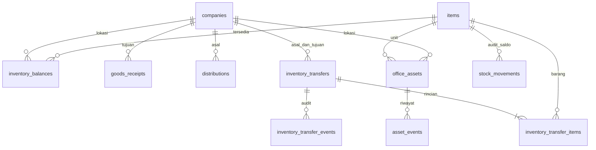

# Multi-PT Inventory dan Aset Kantor

## Audit baseline

Baseline `a3d6858` dari `origin/main`, dikerjakan di `main`. Checkout awal
`production` dipindahkan sebelum perubahan aplikasi; tidak ada push/deploy.

- `Company` memakai tabel `companies`, soft delete, tanpa master gudang.
- PO mempunyai PT penerbit dan snapshot; relasi historis dapat NULL.
- `StockService` sebelumnya menulis saldo global dan audit dalam transaksi.
- GRN baru menambah stok saat konfirmasi, setelah mengurangi barang rusak.
- Distribusi aktif saat ini Preparing → Completed. API approval/penerimaan
  lama tetap tersedia. Fitur ini tidak menghidupkan kembali approval HR atau
  konfirmasi akun karyawan yang sebelumnya sudah dihapus dari alur aktif.
- Role nyata mencakup super_admin, hr, general_manager, staff_hr dan
  staff_hr_ga. Assignment RBAC tidak disinkronkan ulang oleh migrasi.

## Keputusan dan sumber saldo

`inventory_balances(item_id, location_key)` adalah sumber saldo tersedia.
`company_id` merujuk master PT yang sama dengan PO. location_key adalah ID
PT atau 0 untuk saldo lama yang belum diketahui lokasinya. Bucket 0 bukan PT
baru dan tidak dapat dipilih sebagai asal distribusi/transfer.

`items.stock_quantity` dipertahankan sebagai proyeksi SUM seluruh saldo
tersedia (termasuk bucket lama), diperbarui secara atomik oleh InventoryLedger.
Tidak ada endpoint yang menulis saldo tersebut langsung. Jangan menulisnya
melalui SQL, Eloquent, seeder, atau aplikasi versi lama setelah migrasi.

Total terkontrol = tersedia + transfer Sent + aset in_use/damaged. Aset yang
sedang digunakan tidak termasuk saldo tersedia. Ringkasan kuantitas berbagai
barang bersatuan berbeda hanya agregat operasional; rincian per barang/PT
adalah laporan kuantitas yang bermakna, bukan nilai akuntansi.

Barang lama default consumable agar migrasi tidak mengarang identitas aset.
Alokasikan saldo lama ke PT berdasarkan pemeriksaan fisik, kemudian ubah
jenis melalui master barang. Konversi aset juga menolak PO/penerimaan aktif dengan jumlah pecahan agar dokumen lama tidak macet. Konversi memerlukan saldo utuh, seluruhnya
sudah diketahui PT-nya; setiap unit mendapatkan kode unik dan event asal.
Aset tidak otomatis merupakan aset tetap akuntansi.

## ERD



Foreign key saldo/PT membatasi penghapusan fisik. Unique(item, location_key)
mencegah saldo ganda, CHECK mencegah negatif dan pasangan lokasi tidak valid.
Kode aset serta operation_key event unik. Pergerakan transfer memiliki
unique(transfer_item_id, movement_type), sehingga satu arah hanya sekali.

## Alur dan kontrak API

- PO baru wajib company_id. Snapshot dan alur HR/GM/pembayaran dipertahankan.
- GRN company_id default PT penerbit PO dan dapat dioverride. GRN historis
  tetap tidak diinferensikan lokasinya. Pending historis perlu dipilih PT-nya;
  replay dokumen confirmed tidak menambah stok kembali.
- Distribusi baru wajib PT asal. Dokumen pending lama memakai aksi Pilih PT asal yang diaudit; dokumen yang sudah dikirim tidak dapat dipindahkan PT-nya. Consumable dipakai dan keluar stok; aset
  harus memilih asset_ids tepat sejumlah unit dan dicatat pemegang namanya.
- Adjustment wajib PT pada HTTP API; expected_quantity dan fingerprint
  idempotency mencakup lokasi. Koreksi aset berkurang melalui kondisi/retur,
  bukan menghilangkan kode aset dengan adjustment negatif.
- Transfer Draft → Sent → Received: kirim mengurangi asal, terima menambah
  tujuan; selang waktu Sent merupakan in transit. Cancel hanya Draft.
  Transfer terkirim dikoreksi dengan menerima lalu membuat transfer balik;
  audit asal tetap utuh. Belum ada penerimaan transfer parsial.
- Aset available → in_use saat penugasan, kembali available setelah kondisi
  diperiksa; damaged tetap tidak tersedia. Reassign mengubah pemegang tanpa
  menambah/mengurangi jumlah. Transfer menggunakan unit aset yang sama.
- Identitas pemegang tetap nama bebas, mengikuti distribusi yang berjalan;
  serial number pabrik opsional.

Endpoint baru:

| Endpoint | Permission |
|---|---|
| GET /api/v1/inventory/companies | salah satu izin operasional terkait |
| GET /api/v1/inventory/overview | inventory.view |
| POST /api/v1/inventory/reconcile | inventory.reconcile |
| GET /api/v1/inventory-transfers, /{id} | inventory.transfer.view |
| POST/PATCH /api/v1/inventory-transfers[/{id}] | inventory.transfer.create |
| POST /api/v1/inventory-transfers/{id}/send | inventory.transfer.send |
| POST /api/v1/inventory-transfers/{id}/receive | inventory.transfer.receive |
| POST /api/v1/inventory-transfers/{id}/cancel | inventory.transfer.create |
| GET /api/v1/assets[/{id}] | assets.view |
| POST /api/v1/assets/{id}/assign,reassign,return,condition | assets.manage |

Transfer menggunakan from_company_id, to_company_id,
items[{item_id,quantity,asset_ids}]. Rekonsiliasi menggunakan item_id,
company_id,quantity,reason,idempotency_key UUID. Aksi aset menggunakan
operation_key UUID, holder_name/condition sesuai tindakan, dan reason.
Lookup unit hanya memaparkan identitas aset tersedia, tidak riwayat pemegang.

## Berkas implementasi

- migrations/2026_11_26_120001: saldo per PT dan kolom integrasi existing.
- migrations/2026_11_26_120002: transfer, unit aset, event.
- migrations/2026_11_26_120003: registrasi izin tanpa pemberian ke role.
- backend/app/Domain/Inventory: InventoryLedger, ReconcileInventory,
  StockService dan InventoryBalance.
- backend/app/Domain/Transfer dan Asset: model dan workflow lifecycle.
- backend/app/Http: controller, request, resource JSON; routes/api/inventory.php.
- Item, GRN, distribusi, adjustment dan mutasi existing: integrasi PT/jenis.
- frontend/features/modules: form, filter PT, adjustment dan rekonsiliasi.
- frontend/features/inventory, dashboard, navigasi, app/(cms)/assets dan
  inventory-transfers: halaman operasional mengikuti komponen existing.
- backend/tests: integrasi, migrasi dan worker koneksi paralel terisolasi.

## Migrasi existing dan urutan rilis

1. Backup DB dan file attachment; catat checksum/count/saldo per barang.
2. Maintenance window: hentikan penulisan UI, queue worker, cron dan versi
   aplikasi lama. Perubahan kolom/proyeksi memerlukan satu cutover, bukan
   menjalankan dua versi stock writer bersamaan.
3. Deploy kode backend+frontend yang sudah diuji sebagai satu rilis.
4. Jalankan migrate biasa, tidak fresh/wipe/seed demo. Seluruh saldo lama
   disalin utuh ke bucket NULL/0. PO, GRN, distribusi historis tidak diubah.
5. Verifikasi SUM saldo tiap item sama dengan proyeksi; cocokkan hasil backup.
6. Administrator memberikan izin baru secara selektif melalui Role & Permission.
7. Alokasikan stok belum diketahui PT menggunakan rekonsiliasi beralasan
   dan UUID. Dua audit (keluar unknown/masuk PT) menjaga total tetap sama.
8. Klasifikasikan aset lama setelah rekonsiliasi dan pemeriksaan unit fisik.
9. Smoke test GA→K35, GRN tujuan override, distribusi, penugasan dan retur.
10. Aktifkan kembali aplikasi/worker setelah semua pengecekan berhasil.

Ekspansi saldo dan aset tidak menghapus data existing. MySQL DDL tidak
sepenuhnya transactional: backup dan maintenance window wajib disiapkan
sebelum menjalankan migrasi pada database besar; jangan menandai migrasi
parsial berhasil. Periksa status/schema sebelum melanjutkan setelah error.

Rollback migrasi hanya diperbolehkan sebelum saldo per PT/transfer/aset
terpakai. Sesudah ada transaksi baru, gunakan forward fix atau pulihkan
backup konsisten beserta kode rilisnya. Down menolak penghilangan identitas
PT/aset. Permission/grants tetap dipertahankan untuk recovery.

## Panduan Niagahoster/hPanel setelah persetujuan rilis

Dokumen ini panduan; tidak ada perintah production yang dijalankan di task.

- Pastikan akun hosting menyediakan PHP sesuai composer.lock, Composer,
  SSH, MySQL, serta runtime Node untuk Next.js. PHP CLI dan PHP website dapat
  berbeda; verifikasi `php -v` dan `composer check-platform-reqs`.
- Gunakan document root Laravel ke backend/public, lindungi .env/vendor,
  gunakan environment production terpisah dan APP_DEBUG=false.
- Rilis berasal dari commit main yang sudah direview. Setelah persetujuan,
  maintainer memperbarui production dan memilih branch tersebut pada
  konfigurasi deployment hPanel. Jangan ubah branch deployment saat QA.
- Saat maintenance dan setelah backup: composer install --no-dev
  --prefer-dist --optimize-autoloader; php artisan migrate --force;
  php artisan config:cache; php artisan route:cache; php artisan view:cache.
- Frontend: npm ci, set LARAVEL_API_URL sesuai konfigurasi existing,
  npm run build; jalankan melalui Node.js Web App/konfigurasi Next.js yang
  sudah dipakai hosting, bukan menaruh source Next.js di folder PHP saja.
- Lakukan smoke test memakai akun dengan izin terbatas dan superadmin,
  cocokkan saldo dan audit, lalu akhiri maintenance. Jangan reset DB.

Referensi resmi hosting:
- https://www.hostinger.com/support/how-to-deploy-a-nodejs-website-in-hostinger/
- https://www.hostinger.com/support/6152127-how-to-deploy-laravel-8-at-hostinger/

Panduan Laravel hosting tersebut membahas Laravel 8; gunakan untuk konteks
hPanel/SSH saja. Versi PHP dan perintah rilis mengikuti lockfile proyek ini.

## Pemeriksaan saldo sebelum membuka maintenance

Jalankan query baca-saja berikut di database target setelah migrasi dan
setelah smoke test. Hasil harus kosong; jangan memperbaikinya dengan UPDATE
langsung. Jika ada selisih, hentikan penulisan dan investigasi sumbernya.

```sql
SELECT i.id, i.sku, i.stock_quantity,
       COALESCE(SUM(b.quantity), 0) AS ledger_available
FROM items i LEFT JOIN inventory_balances b ON b.item_id = i.id
GROUP BY i.id, i.sku, i.stock_quantity
HAVING i.stock_quantity <> COALESCE(SUM(b.quantity), 0);
```

Saldo belum diketahui PT tetap dapat dilihat terpisah:

```sql
SELECT item_id, quantity FROM inventory_balances
WHERE company_id IS NULL AND quantity <> 0;
```

## Verifikasi aktual — 26 November 2026

| Gate | Hasil |
|---|---|
| PHPUnit seluruh 38 file (proses serial per file) | 381 tes, 3.118 assertion, lulus |
| Transfer dua koneksi/proses paralel | 2 tes, lulus; tidak overdraw/double-issue |
| Tes frontend Node | 69 tes, lulus |
| TypeScript --noEmit | lulus |
| ESLint seluruh frontend | exit 0; empat warning img existing |
| Next production build --webpack | exit 0; 29 route termasuk assets/transfers |
| Pint berkas PHP berubah | lulus |
| git diff --check | lulus |
| Migrasi purchasing_test | lulus, tanpa fresh/wipe |
| Migrasi purchasing lokal | lulus setelah snapshot; nol selisih saldo |

Pengujian backend dijalankan serial per file untuk menghindari lock fixture
RBAC antarproses. Worker concurrency mempunyai fixture committed tersendiri
di purchasing_test, guard database, dan cleanup berdasarkan ID yang dibuat.
Fixture lama diberi PT eksplisit tanpa mengurangi assertion bisnis.

Database aplikasi lokal memiliki dua barang dengan total saldo awal 0.
Keduanya dipertahankan di bucket lama; dokumen, master PT dan assignment role
sama sebelum/sesudah migrasi. Snapshot lokal ada di storage/app/private/
inventory-before-01M8BA67B4QSTWN3RH3FAAJM9F.json. Data production tidak diakses.

Build sempat memunculkan SecurityFatalError/notice keamanan Next.js existing;
retry berhasil. Sebelum rilis production, tinjau advisory dan kompatibilitas
upgrade dependency tersebut. Fitur ini tidak melakukan upgrade framework.

Bootstrap Laravel Boost dari AGENTS.md tidak dapat dipasang: DNS lokal tidak
menemukan repo.packagist.org pada dry-run. Dependensi yang sudah terpasang
mencukupi untuk menjalankan PHPUnit, Pint dan seluruh pemeriksaan di atas.

Permission baru hanya terdaftar, tidak diberikan otomatis kepada role mana
pun. Setelah login ulang, administrator dapat mengaturnya melalui Access
Role & Permission. Permission berlaku lintas PT; isolasi saldo bukan isolasi
tenant/pembatasan keanggotaan pengguna per PT.
