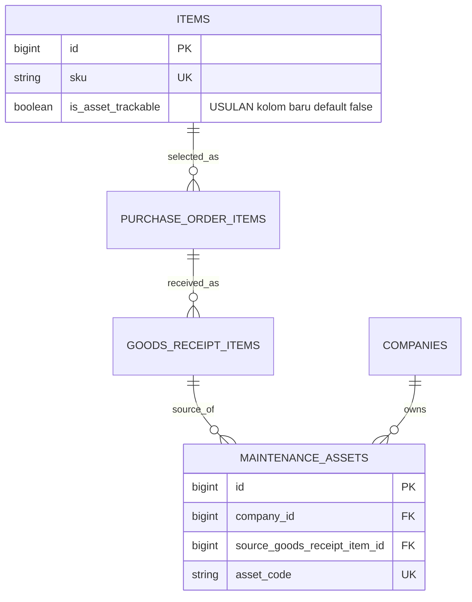

# MGA-R0-010 — Revisi ERD Maintenance R1 v0.8: Registrasi Manual dari GRN Confirmed

**Proyek:** ERP Purchasing & Inventory — Maintenance & General Affairs  
**Tanggal:** 24 November 2026  
**Branch tujuan (penempatan manual):** `feat/maintenance-backend`  
**Path yang disarankan:** `backend/docs/planning/MAINTENANCE_R0_010_ERD_R1_REVISI_DRAFT_v0.8.md`  
**Terkait:** MGA-R0-004, MGA-R0-005 (D-01/D-10/D-11), MGA-R0-009, MGA-R0-010, MGA-R1-003..005  
**Status:** **DRAFT / preferensi awal pengguna**, belum sign-off GA. Dokumen ini tidak membuat schema, API, permission, atau perubahan GitHub.

## 1. Keputusan rancangan sementara: opsi B + opsi A (dibedakan)

Ada **tiga pilihan terpisah** dari pengguna pada 24 November 2026:

1. **Opsi B (waktu kelayakan):** unit baik dari baris GRN yang sudah confirmed boleh diregistrasi, walaupun Order baru `partially_received`; **tidak harus menunggu `completed`**.
2. **Opsi A (siapa yang memicu):** **petugas yang memiliki permission melakukan registrasi manual** dari daftar calon aset GRN confirmed. Sistem menghasilkan kode otomatis **hanya setelah petugas melakukan registrasi**. Konfirmasi GRN tidak membuat aset otomatis, tidak memanggil domain Maintenance dan tidak mengirim job registrasi.
3. **Registrasi sebagian per baris GRN (jawaban 24 Nov 2026):** petugas boleh mengajukan **lebih dari satu batch registrasi** untuk **sumber GRN item yang sama**, misalnya 2 unit hari ini dan 4 unit kemudian dari 6 unit baik. Setiap batch sukses bersifat atomik, bernomor/kode unik, dan memakai idempotency key baru untuk tindakan baru; kuota total per GRN item tidak pernah terlampaui.

Ketiganya merupakan **preferensi rancangan awal**, **bukan sign-off resmi GA**. Jangan mengubah flow Purchase Order/GRN/Order existing.

Tidak ada perubahan pada status PO, Order, GRN, pembayaran, atau distribusi existing. Penambahan ke registrasi aset **bukan** transaksi mutasi stok.

### Ringkasan aturan sementara yang dipertahankan

| Topik | Rancangan sementara | Status |
|---|---|---|
| Cakupan aset | Kendaraan, alat berat, aset kantor, gedung milik/fasilitas; ATK tetap Item Inventory | Preferensi pengguna; D-01 menunggu GA |
| Sumber aset baru | Daftar calon aset (bukan aset aktif) dihitung dari baris GRN confirmed; petugas memilih dan mendaftarkan secara manual | **Opsi B + A + registrasi sebagian dipilih**; belum sign-off |
| Sumber aset lama | Registrasi manual historis oleh HR yang memiliki permission | Preferensi; matriks D-10 menunggu GA |
| Identitas | Satu unit fisik = satu asset record dan satu kode aset berbeda; satu SKU boleh memiliki banyak asset records | Preferensi; format final belum diputuskan |
| Nomor | Dialokasikan otomatis **saat commit registrasi**, berurutan per PT, teks kode unik lintas database | Preferensi; prefix PT dan reset tahunan belum diputuskan |
| Kepemilikan | PT pembeli adalah PT pemilik aset; penggunaan PT lain tidak mengubah pemilik | Preferensi; SOP D-11 menunggu GA |
| Akses | Seluruh role existing dapat dilibatkan dengan permission granular; lintas PT memakai permission | Preferensi; grant permission belum disahkan |
| Gedung | Gedung milik berbeda dari gedung/ruang sewa | Preferensi; detail fasilitas menyusul |

## 2. Verifikasi terhadap kode backend existing (branch maintenance, audit baca-saja)

| Fakta kode yang sudah ada | Lokasi sumber | Implikasi |
|---|---|---|
| `goods_receipts` memiliki `purchase_order_id`, `status`, `confirmed_at` | `database/migrations/2026_11_03_020013_create_goods_receipts_table.php` | Registrasi memeriksa **confirmed_at** dan status sah, bukan sekadar GRN dibuat. |
| `goods_receipt_items` memiliki `goods_receipt_id`, `purchase_order_item_id`, `qty_received`, `qty_damaged` bertipe `DECIMAL(18,3)` | `database/migrations/2026_11_03_020014_create_goods_receipt_items_table.php` | Basis jumlah aset layak adalah **per baris GRN**, bukan kuantitas PO total. |
| `ConfirmGoodsReceipt` mengunci PO → Order → GRN, mengonfirmasi mutasi stok, kemudian menyinkronkan status Order | `app/Domain/Receiving/Actions/ConfirmGoodsReceipt.php` | Registrasi Maintenance hanya membaca penerimaan yang sudah committed; hindari penguncian dengan urutan terbalik yang berisiko deadlock. |
| Sinkronisasi Order menghasilkan `partially_received` atau `completed` menurut progres penerimaan | `app/Domain/Purchasing/Services/OrderStatusSync.php` | `Order.completed` **bukan** prasyarat registrasi opsi B. |
| Item PO mempunyai FK `item_id` dan snapshot barang; PO mempunyai `company_id` yang dapat null | `app/Domain/Purchasing/Models/PurchaseOrderItem.php`; migration perluasan PO | Periksa PT pembeli secara eksplisit; jangan mengambil PT dari pemakai/default user bila data PO kosong. |
| `StockService` merupakan pintu mutasi stok, dan `StockMovement` mencatat GRN/distribusi/adjustment | `app/Domain/Inventory/Services/StockService.php` | **Tidak** menulis `items.stock_quantity` atau membuat stock movement dari registrasi aset. |
| Company saat ini tidak memiliki kolom kode singkat PT | `app/Domain/Company/Models/Company.php`; migration Company | Prefix seperti `IND` hanyalah contoh; sumber prefix harus disepakati sebelum penerapan numbering. |

**Catatan:** referensi path di atas adalah kode yang dibaca, bukan perubahan file. Tidak ada test atau migration Maintenance yang dijalankan dalam revisi dokumen ini.

## 3. Aturan registrasi opsi B (usulan kontrak bisnis)

### 3.1 Gate kelayakan

**Pembedaan tiga objek:** `GRN confirmed` = bukti barang baik masuk Inventory; `calon aset` = hasil query *read-only* terhadap kuota GRN; `aset terdaftar` = record domain Maintenance yang secara eksplisit dibuat petugas berizin. Calon aset **bukan tabel stok baru**, bukan aset otomatis, dan tidak mengubah kuantitas Inventory.

1. User sudah login, akun aktif, dan mempunyai permission registrasi aset dari GRN serta akses ke PT terkait.
2. GRN ada, `confirmed_at` tidak null dan `status` termasuk hasil konfirmasi yang valid: `fully_received`, `partially_received`, atau `discrepancy`.
3. Baris GRN terhubung ke satu item PO yang sah. Item harus **diizinkan sebagai aset per unit** oleh kebijakan klasifikasi yang nanti disahkan; **tidak semua SKU (terutama ATK/spare part)** masuk daftar calon aset. **Preferensi opsi C:** klasifikasi boolean `items.is_asset_trackable` (usulan kolom BARU) pada Master Barang; bukan tabel mapping Maintenance. Rancangan dan pengaturan kewenangan masih menunggu sign-off D-01/D-10.
4. Jumlah unit baik pada baris GRN adalah `qty_received - qty_damaged`, hanya dari GRN terkonfirmasi.
5. Hanya **unit utuh** yang dapat menjadi asset record individual dalam rancangan R1. Karena kolom kuantitas existing adalah `DECIMAL(18,3)`, barang dengan satuan pecahan atau konversi unit perlu aturan khusus, bukan dibulatkan diam-diam.
6. Jumlah unit yang akan didaftarkan tidak boleh melebihi unit baik **yang belum diregistrasi** dari **baris GRN itu**.
7. `purchase_orders.company_id` menjadi sumber PT pemilik jika valid. Bila NULL, perusahaan tidak aktif, atau bukti bertentangan, **baris tidak bisa didaftarkan melalui jalur GRN sampai ada prosedur verifikasi resmi**; jangan diam-diam memakai `users.default_company_id`, nama supplier, maupun jalur *legacy* sebagai cara pintas.
8. Daftar calon aset bersifat **read-only** dan menampilkan kuota tersedia yang dapat berubah saat request lain berhasil. Validasi serta locking harus **diulang ketika POST registrasi**, bukan mempercayai sisa kuota dari GET.
9. Metadata aset per unit diisi/ditinjau petugas sebelum commit; saat POST `units` berisi **N objek untuk N unit aset**, tidak ada pembuatan otomatis massal pada konfirmasi GRN.
10. Tidak diperlukan `orders.status = completed`. GRN confirmed + unit baik yang belum diregistrasi sudah cukup untuk *eligibility* menurut opsi B. **Registrasi tetap sebuah aksi terpisah dan eksplisit**.

### 3.2 Contoh konkret

**PO PT Indorack memesan 10 laptop (SKU yang sama). Petugas memulai registrasi manual dari daftar calon aset.**

| Tahap | Dokumen | Barang baik diterima | Total aset dari baris itu | Hasil |
|---|---|---:|---:|---|
| 1 | GRN-001 Pending | 6 direncanakan | 0 | Belum boleh mendaftarkan aset |
| 2 | GRN-001 Confirmed | 6 | 6 maksimal | Boleh mendaftarkan unit 1–6, Order dapat `partially_received` |
| 3 | Permintaan ulang jumlah sama | — | Tetap 6 | Idempotency mengembalikan hasil sama; tidak menggandakan aset |
| 4 | GRN-002 Confirmed | 4 | Tambahan 4 dari GRN-002 | Unit 7–10 memperoleh kode berbeda; Order dapat `completed` |
| 5 | Permintaan melebihi saldo pada GRN-001 | Mis. minta 1 tambahan setelah 6 sudah terdaftar | Tidak berubah | Ditolak sebagai konflik (HTTP 409) |

Setiap asset record mencatat **PT Indorack** sebagai pemilik. Sistem boleh menautkan semua unit ke SKU laptop yang sama, namun harus membedakan identitas fisiknya (nomor aset, nomor seri bila tersedia).

**Skenario rusak:** GRN menerima 7 unit dengan `qty_damaged = 1`, maka hanya **6 unit** boleh didaftarkan sebagai aset baik pada tahap ini. GRN berstatus `discrepancy` tetap bisa menjadi sumber 6 aset bila `confirmed_at` sudah ada dan jumlah baik positif.

**Skenario registrasi sebagian (preferensi awal sudah dipilih):** petugas boleh mendaftarkan sebagian unit dari **baris GRN yang sama** lalu mendaftarkan sisanya pada tanggal lain. Contoh: GRN confirmed memiliki 6 unit baik → batch #1 mendaftarkan 2 → sisa kuota 4 → batch #2 mendaftarkan 4 → sisa 0. Pilihan ini **masih menunggu sign-off GA**, tetapi tidak perlu ditanyakan ulang sebagai preferensi.

## 3.3. Registrasi sebagian dalam beberapa batch (pilihan terbaru)

**Definisi kuota dan identitas:** satu **baris** `goods_receipt_items.id` merupakan sumber kuota independen. Batch adalah aksi POST manual yang memproses *N unit sekaligus*; bukan izin untuk membuat *N unit* otomatis setelah GRN confirmed.

| Kejadian | Kuota unit baik | Aset terdaftar kumulatif pada GRN item | Sisa calon aset | Hasil |
|---|---:|---:|---:|---|
| GRN confirmed | 6 | 0 | 6 | Tidak ada aset otomatis |
| Batch pertama, 2 unit, key `K1` | 6 | 2 | 4 | Dua kode aset berbeda; 201 |
| Retry batch pertama, key `K1`, payload identik | 6 | 2 | 4 | Hasil lama; 200 |
| Batch kedua, 4 unit, key `K2` | 6 | 6 | 0 | Empat kode baru; 201 |
| Batch ketiga, 1 unit, key `K3` | 6 | 6 | 0 | Ditolak 409; tidak berubah |

**Rumus per baris GRN (khusus unit bulat):**

```text
usable_units = exact_integer(qty_received - qty_damaged)
registered_units = count(ALL maintenance_assets WHERE source_goods_receipt_item_id = X)
remaining_units = usable_units - registered_units

POST valid jika 1 <= count(units) <= remaining_units
```

- Angka `registered_units` mencakup aset berstatus nonaktif, dipindahkan, atau soft-deleted; **nomor asal dan slot penerimaan tidak pernah dipakai ulang**. Pembatalan registrasi yang salah memerlukan SOP reversal terpisah.
- **Satu baris GRN boleh punya banyak batch**, dengan `registration_id` berbeda dan `idempotency_key` berbeda. Kunci yang sama hanya dipakai untuk *retry transaksi batch yang sama*; perubahan jumlah/metadata memakai kunci baru dan dihitung sebagai aksi baru.
- `receipt_unit_ordinal` harus unik per `goods_receipt_item_id` dan meningkat sepanjang histori (contoh batch #1 ordinal 1–2, batch #2 ordinal 3–6). Kode aset per PT menggunakan counter tersendiri yang tidak harus berurutan hanya untuk satu GRN.
- Validasi quota dijalankan **ulang setelah kunci transaksi**. Jika dua petugas mencoba 4 + 4 unit dari kuota sisa 4, hanya satu batch 4 yang boleh sukses; batch lainnya ditolak 409. Kegagalan unit ke-N menyebabkan rollback **seluruh batch tersebut**, bukan batch-batch yang sudah lebih dahulu sukses.
- Untuk GET kandidat, tampilkan `usable_units`, `registered_units`, `remaining_units` dan peringatan bahwa angka dapat berubah; tidak boleh mempercayai `remaining_units` dari frontend sebagai sumber keputusan POST.
- Registrasi bukan mutasi stok. `items.stock_quantity`, `stock_movements`, `goods_receipts.status`, serta `orders.status` tetap tidak berubah oleh batch registrasi ini.

## 4. Proposal ERD R1 yang diperbarui (belum final)

```mermaid
erDiagram
  COMPANIES ||--o{ MAINTENANCE_ASSETS : owns
  COMPANIES ||--o| MAINTENANCE_ASSET_SEQUENCES : allocates_number
  USERS ||--o{ MAINTENANCE_ASSET_REGISTRATIONS : submits
  MAINTENANCE_ASSET_REGISTRATIONS ||--o{ MAINTENANCE_ASSETS : produces
  MAINTENANCE_ASSETS ||--o| MAINTENANCE_VEHICLE_PROFILES : vehicle_details
  MAINTENANCE_ASSETS ||--o{ MAINTENANCE_METER_LOGS : readings
  GOODS_RECEIPTS ||--|{ GOODS_RECEIPT_ITEMS : has
  PURCHASE_ORDER_ITEMS ||--o{ GOODS_RECEIPT_ITEMS : received_as
  GOODS_RECEIPT_ITEMS o|--o{ MAINTENANCE_ASSETS : source_of_units
  PURCHASE_ORDERS ||--o{ PURCHASE_ORDER_ITEMS : has
  COMPANIES o|--o{ PURCHASE_ORDERS : purchasing_owner

  COMPANIES {
    bigint id PK
    string name
  }
  MAINTENANCE_ASSETS {
    bigint id PK
    bigint company_id FK
    string asset_code UK
    bigint sequence_number
    string asset_type
    string asset_name
    string acquisition_source
    bigint source_goods_receipt_item_id FK_nullable
    int receipt_unit_ordinal_nullable
    bigint registration_id FK
    bigint registered_by FK
    string asset_status
  }
  MAINTENANCE_ASSET_SEQUENCES {
    bigint company_id PK_FK
    bigint next_number
    string prefix
  }
  MAINTENANCE_ASSET_REGISTRATIONS {
    bigint id PK
    uuid idempotency_key UK
    char request_fingerprint
    bigint requested_by FK
    string acquisition_source
    bigint goods_receipt_item_id FK_nullable
    int requested_units
  }
  MAINTENANCE_VEHICLE_PROFILES {
    bigint asset_id PK_FK
    string vehicle_type
    string meter_unit
  }
  MAINTENANCE_METER_LOGS {
    bigint id PK
    bigint asset_id FK
    decimal reading_value
    datetime recorded_at
    bigint recorded_by FK
  }
```

### 4.1 Tabel kandidat (tidak dibuat sekarang)

**Catatan desain v0.7:** `maintenance_asset_registrations` berfungsi sebagai *batch* yang diajukan petugas. Daftar calon aset **tidak membutuhkan tabel atau job**: query menggabungkan GRN confirmed, item PO, dan jumlah unit terdaftar. Klasifikasi kelayakan calon aset disimpan di **Master Barang `items.is_asset_trackable`** melalui migration baru; hanya true yang eligible. Flag ini tidak membuat aset otomatis.

| Kandidat tabel | Tujuan & constraint yang diusulkan |
|---|---|
| `maintenance_assets` | Satu baris per aset/unit; FK `company_id`; `asset_code` unique global; `(company_id, sequence_number)` unique; `source_goods_receipt_item_id` nullable untuk legacy; `(source_goods_receipt_item_id, receipt_unit_ordinal)` unique untuk asal GRN bila ordinal dipakai; soft delete perlu evaluasi agar kuota dan audit tidak berubah diam-diam. |
| `maintenance_asset_sequences` | Satu counter per PT (`company_id` PK/FK), `prefix` unik lintas PT, dan `last_sequence`; nomor hanya dialokasikan ketika POST berhasil dalam transaksi, tidak menggunakan `MAX()+1`. Prefix perusahaan perlu disahkan; tabel `companies` existing belum punya kode singkat. |
| `maintenance_asset_registrations` | Batch **registrasi manual** (bukan event GRN otomatis); source `confirmed_grn` atau `legacy_manual`, aktor, PT, idempotency UUID unique, hash payload, jumlah unit dan jejak waktu; satu batch menghasilkan N aset. Semua unit atau tidak satu pun (*atomic*). |
| `items.is_asset_trackable` (**kolom baru pada tabel existing; belum dibuat**) | Boolean `NOT NULL DEFAULT FALSE`; ditetapkan secara eksplisit pada Master Barang oleh aktor berizin. Semua Item existing aman tetap `false`; jangan membuat tabel mapping terpisah untuk opsi C. Perubahan flag memerlukan audit dan permission tersendiri. |
| `maintenance_vehicle_profiles` | Profil khusus kendaraan/alat berat. Jenis meter KM/jam menunggu D-03. |
| `maintenance_meter_logs` | Riwayat angka meter per aset, aktor, timestamp, koreksi beralasan; aturan overdue menunggu D-02/D-03. |

Relasi `purchase_order_id` **tidak perlu diduplikasi** di `maintenance_assets` jika rantai `source_goods_receipt_item_id → goods_receipt → purchase_order` dapat dilacak andal; perlu dipastikan dampak retensi/soft-delete. Contoh di diagram bukan migration siap jalan. Untuk jalur legacy HR, referensi penerimaan null, asal `legacy_manual`, dan PT pemilik dipilih serta dibuktikan sesuai SOP.

### 4.2 Dua constraint berbeda yang wajib dipahami

- **Identitas kode aset:** per PT urutan sendiri, tetapi teks `asset_code` tetap unik **secara global** supaya laporan dan pencarian tidak ambigu.
- **Kuota penerimaan:** gabungan registrasi dari satu `goods_receipt_item_id` tidak boleh melebihi `qty_received - qty_damaged`. Unique ordinal saja **tidak cukup** untuk menjamin tidak over-register jika aplikasi mengalokasikan ordinal secara salah; tetap butuh locking dan hitungan kuota.

## 5. Alur backend yang direkomendasikan (belum implementasi)

1. **GET calon aset** (usulan: `/api/v1/maintenance/asset-candidates`) melakukan query read-only pada baris GRN confirmed dan hanya Item dengan `items.is_asset_trackable = true`. Hasil memuat `eligible`, `usable_units`, `registered_units`, `remaining_units`, identitas Item/PO/GRN dan PT. Tanpa permission atau akses PT, tidak boleh bocor metadata GRN.
2. Petugas memilih sumber GRN dan mengisi **metadata per unit**. Frontend boleh menampilkan kuota, tetapi angka itu tidak menjadi sumber otorisasi.
3. **POST registrasi** (usulan: `/api/v1/maintenance/asset-registrations/from-grn`) menerima `goods_receipt_item_id`, array `units` (setiap objek mewakili satu aset fisik), dan `idempotency_key` UUID. Form Request memvalidasi format/ukuran batch. Rancangan bentuk payload dan respons rinci ada di `MAINTENANCE_R1_ASSET_REGISTRATION_API_CONTRACT_DRAFT_v0.3.md`.
4. Autentikasi Sanctum + `EnsureActiveAccount`, permission granular, dan batas data per PT diuji **di backend**. Role existing tidak diubah.
5. `DB::transaction` memeriksa replay idempotency key (setelah auth/otorisasi); request sama mengembalikan batch dan kode sebelumnya, tetapi request berbeda memakai key sama ditolak.
6. Lock diurutkan konsisten dengan `ConfirmGoodsReceipt`, misalnya **PO → Order → GRN → GRN Item → Item → counter nomor PT**, setelah memperoleh ID terkait lewat pembacaan pendahuluan yang tidak mengunci. Periksa ulang relasi/status/kuota setelah lock. Hindari pengambilan lock GRN sebelum PO yang dapat deadlock.
7. Hitung secara eksak kuota unit baik (jangan gunakan float), baca **semua** aset asal GRN termasuk soft-deleted/retired (slot tetap terpakai). *Hard-delete* aset dari GRN tidak boleh mengosongkan kuota. Tolak jika `count(registered) + count(units)` melewati kuota.
8. Tentukan `receipt_unit_ordinal` per unit secara terkunci dan unik. Alokasikan kode per PT melalui counter yang terkunci dan simpan batch, aset per unit, dan audit dalam **satu transaksi**. Unique DB adalah pertahanan terakhir saat request simultan.
9. `COMMIT`; hasil mengembalikan `registration_id`, daftar kode aset per unit dan sisa kuota. Jika satu langkah gagal, **semua baris batch dibatalkan/rollback**. Replay dengan key dan payload identik mengembalikan ID/kode lama.
10. **Jangan panggil `StockService` untuk mengubah saldo** dalam langkah registrasi ini. Registrasi aset ≠ pengeluaran barang. Jika aset keluar gudang, gunakan workflow distribusi/serah-terima yang kelak disahkan tanpa mengubah waktu pengurangan stok `Sent` existing.

### Kewaspadaan tambahan

- Mengunci banyak baris/mengalokasikan nomor pada transaksi yang sama bisa menimbulkan contention. Untuk batch besar, putuskan batas jumlah unit per request dan uji concurrency.
- `idempotency_key` perlu unik dan fingerprint memuat seluruh input relevan agar retry tidak menghasilkan aset ganda.
- Untuk kebutuhan aset dengan nomor seri pabrik, aturan uniqueness nomor seri serta status "belum diketahui" perlu disetujui. Kode aset ERP bukan otomatis nomor seri pabrik.
- Perubahan status aset, pembatalan pendaftaran yang salah, dan transfer kepemilikan PT harus berupa prosedur dengan audit; **tidak** memakai delete bebas atau mengubah `company_id` via PATCH biasa.
- Registrasi aset di Maintenance dan persediaan SKU di Inventory adalah **dua representasi berbeda**. Aset yang sudah diregistrasi belum tentu sudah dikeluarkan dari gudang; laporan harus membedakan keduanya.

## 6. Proposal RBAC yang terpengaruh opsi B (belum grant role)

| Aksi | Kandidat permission | Kontrol lain |
|---|---|---|
| Lihat daftar / detail aset | `maintenance.assets.view` | Scope PT sesuai permission lintas PT |
| Lihat aset semua PT | `maintenance.assets.view-all-companies` | Tidak memberi hak edit |
| Registrasi unit dari GRN confirmed | `maintenance.assets.register-from-receipt` | Periksa GRN, kuota, PT, idempotency, kelayakan aset |
| Registrasi aset lama oleh HR | `maintenance.assets.register-legacy` | Pembuktian PT, source `legacy_manual`, audit |
| Edit metadata aset | `maintenance.assets.manage` | Tidak boleh mengubah ownership/sumber via edit biasa |
| Edit lintas PT | `maintenance.assets.manage-all-companies` | Grant eksplisit |
| Membaca daftar calon aset GRN confirmed | `maintenance.assets.candidates.view` (**usulan**) + PT scope | Endpoint read-only dengan field minimal; tidak membuka `grn.view` global |
| Membaca data GRN untuk registrasi | Permission Maintenance yang tepat + policy record | Akses GRN operasional existing tidak boleh dibuka bebas |
| Koreksi pembacaan KM | `maintenance.meters.correct` | Reason, jejak before/after |

Seluruh role existing (`super_admin`, `hr`, `staff_hr`, `general_manager`) **belum diberi** permission ini. Penetapan permission aktual menunggu matriks D-10 dan sign-off GA.

## 7. Acceptance tests untuk opsi B (untuk ditulis nanti, belum dijalankan)

| ID | Skenario | Harapan |
|---|---|---|
| ASSET-GRN-01 | GRN `pending` dengan 6 laptop | HTTP 409, tidak ada aset maupun stok baru |
| ASSET-GRN-02 | GRN confirmed 6 unit baik, Order `partially_received` | GET menampilkan calon aset; **tidak** membuat aset. POST oleh petugas berizin dapat mendaftarkan 6 unit |
| ASSET-GRN-03 | GRN confirmed 7 diterima dan 1 rusak | Maks. 6 aset; bukan 7 |
| ASSET-GRN-04 | GRN confirmed semua rusak | Ditolak, tidak ada aset dari baris ini |
| ASSET-GRN-05 | GRN-001 sudah menghasilkan 6 aset, GRN-002 kemudian 4 | Total 10 aset berkode berbeda dari dua sumber GRN |
| ASSET-GRN-06 | Register 6 aset lalu submit key sama + payload sama | Replay mengembalikan 6 kode lama; tidak menciptakan baris tambahan |
| ASSET-GRN-07 | Key sama dipakai untuk payload berbeda | HTTP 409, tidak menciptakan aset |
| ASSET-GRN-08 | Dua request berbeda bersamaan mendaftarkan 6+6 unit dari GRN yang kuotanya 6 | Maks. hanya 6 berhasil; tanpa double registration |
| ASSET-GRN-09 | Dua batch 3+3 pada GRN 6 unit | Kuota habis setelah total 6; ordinal dan kode tidak bertabrakan; registrasi parsial adalah preferensi awal |
| ASSET-GRN-10 | `purchase_orders.company_id` null | Tidak mengarang PT pemilik; kirim ke proses verifikasi sesuai kontrak |
| ASSET-GRN-11 | User tanpa login / tanpa permission | HTTP 401 / 403; data PT lain tidak bocor |
| ASSET-GRN-12 | Konfirmasi GRN pernah membuat stock movement `grn_in` | Registrasi tidak membuat stock movement kedua, saldo tidak berubah; **GRN confirm sendiri tidak menciptakan asset record** |
| ASSET-GRN-13 | Pembelian 10 laptop PT Indorack | Semua asset `company_id` = PT Indorack, kode unik dengan urutan PT |
| ASSET-GRN-14 | Error saat membuat aset unit ke-5 dari batch 6 | Rollback seluruh batch, tidak ada nomor yang diterbitkan / aset setengah tersimpan |
| ASSET-GRN-15 | `qty_received - qty_damaged` pecahan, satuan tidak cocok aset unit | Ditolak/diarahkan review sesuai aturan unit yang disahkan; tidak dibulatkan otomatis |
| ASSET-GRN-16 | HR mendaftarkan legacy tanpa referensi PO/GRN, izin sah | Aset dari sumber `legacy_manual`, PT pemilik eksplisit, audit tersedia |
| ASSET-GRN-17 | Aset PT Indorack dipakai PT SMT | PT pemilik tidak berubah kecuali ada proses mutasi yang disahkan |

**Regression wajib:** PO approval + Order creation; GRN Pending/confirmed/partial/damaged; stock movements; Distribution Sent; finance dan dokumen tetap lulus. Baseline yang terakhir diverifikasi sebelum penambahan modul: **346 tests / 2.722 assertions** pada commit `9583abd` melalui CI (bukan hasil tes file draft ini).

## 8. Hal yang masih membutuhkan konfirmasi (tidak menghalangi penyusunan dokumen)

1. **Sudah dijawab sebagai preferensi:** petugas berizin memicu registrasi **manual** dari daftar calon aset GRN confirmed. **Tetap perlu sign-off GA** sebelum implementasi. Tidak perlu menanyakan manual vs otomatis lagi.
2. **Klasifikasi barang (opsi C sudah dipilih):** penanda khusus pada Master Barang (`items.is_asset_trackable`, usulan) membedakan SKU yang bisa didaftarkan sebagai aset dari ATK/spare part. **Pilihan awal terbaru:** hanya role `super_admin` atau `hr` yang memiliki permission `maintenance.asset-items.classify`; audit tetap diwajibkan. Belum sign-off GA. Tidak perlu menanyakan lagi A/B/C.
3. **Nomor per PT:** format yang dipilih (mis. `IND-AST-000001`, `SMT-AST-000001`), sumber kode pendek PT stabil, serta apakah angka urut reset tahunan. Tidak boleh menebak prefix dari nama PT.
4. **Registrasi parsial:** pengguna sudah memilih **boleh 2 unit dahulu lalu 4 menyusul** dari satu baris GRN berkuota 6. Masih menunggu sign-off GA; tidak perlu diputuskan ulang pada tingkat preferensi.
5. **Kewenangan awal:** siapa di antara role existing yang dapat menjalankan `register-from-receipt`? Penggunaan seluruh role tidak berarti seluruhnya otomatis memperoleh permission.
6. **Data PO lama tanpa PT:** apakah perlu penetapan PT lewat proses verifikasi yang diaudit atau referensi dokumen historis? Jangan langsung menulis atribut historis PO tanpa SOP.
7. **Satuan dan serialisasi:** tentukan unit yang eligible untuk registrasi per unit; `DECIMAL(18,3)` bukan bukti semua SKU berjumlah bulat.

## 9. Definition of Done dan batas langkah berikutnya

- **MGA-R0-010**: dokumen v0.7 siap diskusi. **Belum DONE** sampai FK, constraint, ownership, numbering dan kebijakan registrasi disepakati serta ERD final disahkan.
- **MGA-R0-004**: matriks 23 kebutuhan tetap perlu review GA.
- **MGA-R0-005**: D-01/D-10/D-11 serta detail opsi B tetap preferensi awal, bukan sign-off formal.
- **MGA-R1-003/004/005**: migration, model, API, permission dan tests belum dikerjakan.
- **Tidak** membuat atau mengubah file di GitHub, migration lama, database production, role existing, atau status Purchasing/Inventory.

## 10. Jejak perubahan

| Versi | Tanggal | Perubahan |
|---|---|---|
| v0.3 | 24 November 2026 | Preferensi awal kepemilikan per PT, registrasi legacy, role existing, numbering per PT dan pemisahan gedung milik/sewa. |
| v0.4 | 24 November 2026 | **Opsi B dipilih**: registrasi aset bertahap dari baris GRN confirmed tanpa menunggu Order completed; rancangan kuota per GRN item, idempotensi, concurrency, RBAC dan test cases ditambahkan. |
| v0.5 | 24 November 2026 | **Opsi A dipilih untuk pemicu registrasi**: tidak ada auto-create setelah GRN confirm; petugas berizin memilih kandidat dan POST eksplisit; kontrak API dan status draft diperinci. |
| v0.6 | 24 November 2026 | **Registrasi sebagian boleh**: beberapa batch manual dari baris GRN yang sama (2 + 4 dari kuota 6), masing-masing kunci idempotensi sendiri; ledger kuota per GRN item, ordinal tidak dipakai ulang, concurrency dan rollback per batch dijelaskan. Belum sign-off GA. |
| v0.7 | 24 November 2026 | **Opsi C**: klasifikasi aset pada Master Barang (`items.is_asset_trackable`, migration additive), default false, permission dan audit terpisah; kandidat serta POST wajib cek flag. Belum sign-off GA. |
| v0.8 | 24 November 2026 | **Aktor klasifikasi dipilih**: hanya role `super_admin` atau `hr` **dan** permission khusus `maintenance.asset-items.classify` yang boleh mengubah flag; tidak ada grant otomatis. R1-001/R1-002 diturunkan menjadi proposal domain dan matriks. Belum sign-off GA. |

## 11. Rencana komponen Laravel 13 (USULAN; jangan dibuat sebagai implementasi sebelum sign-off)

| Path baru yang diusulkan | Fungsi | Prasyarat |
|---|---|---|
| `app/Domain/Maintenance/Models/MaintenanceAsset.php` | Model aset satu unit | ERD D-01/D-11 final |
| `app/Domain/Maintenance/Models/MaintenanceAssetRegistration.php` | Rekam batch manual + idempotensi | Migration R1 |
| `app/Domain/Maintenance/Models/MaintenanceAssetSequence.php` | Counter kode per PT | Prefix PT disepakati |
| `app/Domain/Maintenance/Actions/RegisterAssetsFromConfirmedGrn.php` | Transaction, locks, kuota dan create N aset | GRN/stock boundary disetujui |
| `app/Domain/Maintenance/Queries/ListAssetCandidates.php` | Query read-only GRN eligible | D-01/D-10 dan klasifikasi Master Barang disetujui |
| `app/Http/Requests/V1/Maintenance/RegisterAssetsFromGrnRequest.php` | Validasi payload per unit | API contract final |
| `app/Http/Controllers/Api/V1/MaintenanceAssetRegistrationController.php` | Endpoint explicit POST dan replay | RBAC D-10 final |
| `app/Http/Resources/Api/V1/MaintenanceAssetResource.php` | Output aset | Model final |
| `tests/Feature/Api/V1/MaintenanceAssetRegistrationTest.php` | Status, izin, kuota, retry, rollback | Test DB MySQL terisolasi |

**Migration yang diusulkan saat gate terpenuhi:** satu migration additive baru pada `items` untuk klasifikasi dan tiga migration *baru* untuk `maintenance_asset_sequences`, `maintenance_asset_registrations`, dan `maintenance_assets`; tidak diperlukan tabel mapping eligibility tersendiri pada opsi C. Jangan edit migration `goods_receipts`, `goods_receipt_items`, `items` atau `stock_movements` existing; tambah kolom `items.is_asset_trackable` lewat migration BARU (bukan mengedit migration lama).

**Status task:** MGA-R0-010 = *IN PROGRESS (draft v0.8)*, bukan DONE. MGA-R1-003/004/005 = belum implementasi, menunggu keputusan D-01/D-10/D-11 dan SOP akses per PT.


## 12. Penetapan baru v0.7 — Klasifikasi aset melalui Master Barang (opsi C)

**Preferensi pengguna 24 November 2026:** sumber penentu sebuah SKU dapat menjadi calon aset adalah **Master Barang**, bukan keputusan ad-hoc per GRN oleh HR/GA dan bukan penandaan oleh Purchasing pada PO. Ini adalah **keputusan desain awal, BUKAN sign-off GA**.

### 12.1 Aturan inti

- Pada model Item existing, usulkan kolom **`items.is_asset_trackable BOOLEAN NOT NULL DEFAULT FALSE`** melalui **migration baru**, bukan mengedit migration lama. Nama kolom masih usulan teknis, boleh direvisi pada sign-off.
- Setiap SKU yang bisa menghasilkan aset unit per unit disetel `true` oleh aktor yang mempunyai permission khusus. Contoh: laptop, printer, kendaraan; penentuan setiap SKU wajib eksplisit (tidak disimpulkan hanya dari nama/kategori).
- ATK, bahan habis pakai, spare part dan barang non-aset tetap `false`. Nilai `false` pada Item yang sudah ada menjaga perilaku ERP existing saat migration nanti dijalankan, tetapi data historis harus diklasifikasikan secara terkontrol bila hendak diregistrasi.
- Flag klasifikasi adalah **izin/eligibility untuk registrasi**, bukan pengubah saldo Item, bukan penentu PT pemilik, dan **bukan** instruksi membuat aset otomatis.
- Aset lama jalur `legacy_manual` bukan turunan SKU/GRN; data itu tetap ditangani dengan bukti PT dan otorisasi HR terpisah, sesuai SOP yang menunggu pengesahan.
- `items.is_asset_trackable = true` sendiri tidak cukup untuk POST: sistem tetap memvalidasi GRN `confirmed_at`, status, unit baik, sisa kuota, PO.company_id, user permission dan scope PT.
- Perubahan flag dari `true` ke `false` **tidak menghapus atau menyusutkan aset yang sudah terdaftar**, tidak membebaskan slot ordinal GRN, dan tidak mengubah histori. Konsekuensi calon aset dari GRN lama perlu diuji; usulan: perubahan klasifikasi berlaku untuk registrasi baru selanjutnya dan terekam audit actor, waktu, old/new, alasan.
- Akses mengubah klasifikasi **dipisah dari** `items.create`/`items.manage` agar pembuatan Item oleh `staff_hr` tidak otomatis membolehkan menaikkan semua SKU menjadi aset. **Kandidat permission:** `maintenance.asset-items.classify` (guard `web`); belum dibuat/diberikan ke role mana pun.

### 12.2 Relasi pilihan C



**Catatan teknis:** item master **tidak memiliki `company_id`** dalam schema existing. PT pemilik setiap aset ditentukan dari PO (dan validasi kepemilikan), bukan dari Item; SKU yang sama dapat dibeli PT berbeda sehingga menghasilkan aset dengan `company_id` berbeda.

### 12.3 Dampak ke kode existing (DAFTAR USULAN, BELUM DIUBAH)

| Path | Perubahan yang diusulkan nanti | Catatan risiko |
|---|---|---|
| `database/migrations/<timestamp>_add_asset_trackable_to_items_table.php` | Tambahkan kolom boolean default false, dan `down()` menghapus kolom hanya pada DB uji yang aman | Tidak menyentuh kolom stok atau migration existing |
| `app/Domain/Item/Models/Item.php` | Cast boolean; jangan jadikan flag mass-assignable lewat CRUD umum tanpa kebijakan akses khusus | `items.create` oleh staff_hr bukan izin klasifikasi |
| `app/Http/Resources/Api/V1/ItemResource.php` | Tampilkan `is_asset_trackable` read-only bagi user yang berhak melihat master | Hindari kebocoran field sensitif masa depan |
| `app/Http/Requests/V1/Item/StoreItemRequest.php`, `UpdateItemRequest.php` | Usulan aman: `is_asset_trackable` **prohibited** pada endpoint CRUD existing; nilai ditetapkan lewat aksi klasifikasi khusus | Mencegah eskalasi dari `items.create`/`items.manage` biasa |
| `app/Domain/Item/Actions/SaveItem.php` | Pertahankan daftar `EDITABLE` seperti sekarang; update flag lewat action dengan permission & audit tersendiri | Jangan mengganggu CRUD dan stock limits |
| `app/Domain/Maintenance/Actions/UpdateItemAssetClassification.php` (baru) | Lock Item, validasi reason/actor, ubah flag & tulis audit dalam DB transaction | Jangan langsung manipulasi stock quantity |
| `app/Http/Controllers/Api/V1/MaintenanceItemClassificationController.php` (baru) | PATCH endpoint klasifikasi dengan permission, Form Request, 403/422 | Masuk group auth:sanctum + EnsureActiveAccount |
| `app/Domain/Maintenance/Queries/ListAssetCandidates.php` (baru) | Filter Item eligible melalui relasi PO Item; read-only | `is_active` item tidak menggantikan status GRN |
| `app/Domain/Maintenance/Actions/RegisterAssetsFromConfirmedGrn.php` (baru) | **Re-check** flag pada Item yang dikunci sebelum membuat N aset; kunci diurutkan konsisten dengan GRN | 409 jika item tak eligible; tidak mutasi stok |
| `tests/Feature/Api/V1/ItemApiTest.php` + `MaintenanceAssetRegistrationTest.php` | Tests default false, unauthorized classification, kandidat, replay, race, regression | Jalankan di MySQL test isolated |

Usulan endpoint klasifikasi (bukan implementasi):

`PATCH /api/v1/maintenance/item-classifications/{item}` — permission `maintenance.asset-items.classify`; body `{ "is_asset_trackable": true, "reason": "Laptop menjadi aset tetap" }`. Pilihan ini mempertahankan pembatasan role **existing** pada `PATCH /api/v1/items/{item}` tanpa mengubahnya. Approval siapa dapat mengubah klasifikasi masih menunggu D-10.

### 12.4 Skenario test tambahan (belum dijalankan)

- C-01: Item existing setelah migration tetap `is_asset_trackable=false`.
- C-02: user dengan `items.create` tetapi tanpa `maintenance.asset-items.classify` tidak bisa menandai barang sebagai aset (403); guest 401.
- C-03: SKU laptop dengan flag true masuk GET kandidat hanya jika GRN confirmed; SKU pulpen false tidak masuk.
- C-04: memaksa POST dari SKU false ditolak 409, sekalipun user memalsukan kandidat/frontend.
- C-05: flag true tidak membuat aset otomatis pada GRN confirm; batch manual 2 lalu 4 tetap sah dan idempoten.
- C-06: mengganti flag true→false memblokir **registrasi baru**, tetapi tidak menghapus/mengubah aset historis atau kuota yang sudah digunakan.
- C-07: perubahan klasifikasi diaudit sebelum/sesudah, aktor dan alasan; rollback bila audit gagal.
- C-08: kondisi balapan antara perubahan klasifikasi dan registrasi ditangani lewat lock yang konsisten; tidak menghasilkan aset setelah item dinyatakan ineligible di transaksi yang lebih dulu commit.
- C-09: Item SKU sama dibeli PT Indorack dan PT SMT menghasilkan aset PT berbeda tanpa menduplikasi SKU atau mengubah saldo.

### 12.5 Keputusan yang masih ditunggu

1. **D-10 / otorisasi:** role existing mana yang **boleh mengaktifkan/menonaktifkan klasifikasi** (`super_admin`, `hr`, `staff_hr`, `general_manager`)? Draf merekomendasikan permission khusus, bukan otomatis semua role.
2. **D-01:** apakah setiap SKU eligible **wajib satuan unit fisik** seperti `pcs`, atau ada satuan lain yang dapat diregistrasi per unit? Tidak mengonversi pecahan secara otomatis.
3. **D-11:** format prefix kode PT dan reset nomor tahunan masih perlu ditetapkan.
4. Kebijakan audit/retensi klasifikasi dan approval GA masih menunggu tanda tangan pemilik proses.

**Gate:** v0.7 masih `MGA-R0-010 IN PROGRESS`. Belum migration, belum API, belum test baru, dan **tidak ada perubahan GitHub**.


## 13. Addendum v0.8 — Otorisasi klasifikasi: Super Admin / HR + permission khusus

**Preferensi terbaru pengguna, 24 November 2026:** pengguna memilih opsi B dari pertanyaan kewenangan, yaitu **`super_admin` dan `hr`**, masing-masing **harus diberikan permission khusus**. Ini **belum sign-off GA**, sehingga tidak boleh langsung diterapkan ke production. Jawaban ini memperjelas salah satu bagian **D-10**, tetapi **D-10 secara keseluruhan masih PENDING** untuk aksi Maintenance lain dan pengesahan GA.

### 13.1 Aturan akses yang harus terpenuhi sekaligus

Untuk mengubah `items.is_asset_trackable`, diperlukan **kedua kondisi**:

1. Akun aktif, login Sanctum, dan memiliki minimal satu role **`super_admin` atau `hr`**, menggunakan guard existing **`web`**.
2. Akun secara eksplisit memiliki permission **`maintenance.asset-items.classify`** (melalui role atau assignment sah).

`items.create`, `items.manage`, `maintenance.assets.register-from-receipt`, dan akses melihat semua PT **bukan** pengganti kedua kondisi tersebut. Pengguna `staff_hr` atau `general_manager` tetap **403** walaupun permission klasifikasi kelak diberikan secara keliru, karena role tidak memenuhi allowlist; akun `hr` tanpa permission juga **403**. Super Admin juga tidak otomatis melompati kebutuhan permission khusus. Admin dapat memberikan permission kepada peran yang diizinkan **hanya setelah matriks resmi disetujui**.

**Ilustrasi policy, bukan file PHP siap pasang:**

```php
public function canClassify(User $actor, Item $item): bool
{
    $allowedRole = $actor->hasRole('super_admin', 'web')
        || $actor->hasRole('hr', 'web');

    return $allowedRole
        && $actor->can('maintenance.asset-items.classify');
}
```

Di controller/route nantinya, kombinasikan `auth:sanctum`, `EnsureActiveAccount`, permission middleware **dan** policy/role check. `FormRequest` harus menolak perubahan `is_asset_trackable` melalui endpoint CRUD Item lama (`prohibited`); hanya endpoint khusus klasifikasi yang menerima flag dan alasan perubahan.

### 13.2 Matriks minimum (usulan, belum grant)

| Role existing | Permission `classify` | PATCH klasifikasi | Catatan |
|---|---:|---|---|
| `super_admin` | Ada | 200 jika valid | Tidak ada bypass tanpa permission |
| `super_admin` | Tidak ada | 403 | Permission tetap wajib |
| `hr` | Ada | 200 jika valid | HR bisa mengelola klasifikasi, tidak berarti semua aksi registrasi otomatis |
| `hr` | Tidak ada | 403 | Tidak otomatis dari `items.manage` |
| `staff_hr` | Ada/tidak ada | 403 | Tidak lolos batas role yang dipilih |
| `general_manager` | Ada/tidak ada | 403 | Tidak lolos batas role yang dipilih |
| Guest | — | 401 | Tidak boleh mengungkap data Item |

**Aksi lain tetap berbasis permission tersendiri:** melihat calon aset, registrasi dari GRN, registrasi aset lama oleh HR, membaca data lintas PT, serta koreksi KM tidak otomatis mengikuti izin klasifikasi. Rancangan lengkap di `MAINTENANCE_R1_002_RBAC_MATRIX_DRAFT_v0.1.md`.

### 13.3 Integritas dan isu yang belum final

- `is_asset_trackable` hanya klasifikasi SKU; tidak membuat aset, mengubah stok, atau mengganti GRN/Order/PO.
- Perubahan flag wajib dicatat sebagai audit append-only (actor, alasan, sebelum/sesudah, waktu) dalam satu transaksi; kegagalan audit membatalkan perubahan flag.
- Ketika ada registrasi yang sedang berlangsung, aksi klasifikasi harus menggunakan lock/urutan konsisten agar perubahan flag dan POST registrasi tidak saling menyalip.
- **Perubahan klasifikasi menjadi true pada SKU lama:** perlakuan terhadap GRN historis (langsung eligible atau perlu verifikasi/backfill) **belum diputuskan**. Jangan membuka semua penerimaan historis otomatis.
- **Perubahan menjadi false setelah aset sudah ada:** histori dan kuota yang telah terpakai tidak dihapus; registrasi berikutnya tertahan sampai klasifikasi valid lagi sesuai SOP.
- Tidak ada migration/schema/API/role permission yang diubah saat menyusun addendum ini.

### 13.4 Tambahan skenario feature tests (belum dijalankan)

| ID | Kasus | Hasil rencana |
|---|---|---|
| RBAC-CL-01 | `super_admin` + permission | PATCH klasifikasi 200 dan audit |
| RBAC-CL-02 | `hr` + permission | PATCH klasifikasi 200 dan audit |
| RBAC-CL-03 | `super_admin` tanpa permission | 403 |
| RBAC-CL-04 | `hr` tanpa permission | 403 |
| RBAC-CL-05 | `staff_hr` diberi permission klasifikasi | 403 (role tidak diizinkan) |
| RBAC-CL-06 | `general_manager` diberi permission klasifikasi | 403 (role tidak diizinkan) |
| RBAC-CL-07 | `staff_hr` bisa `items.create`, menaruh flag saat POST Item | 422 (`prohibited`) |
| RBAC-CL-08 | `hr` + permission melakukan PATCH Item umum dengan flag | 422; hanya endpoint khusus |
| RBAC-CL-09 | Guest / inactive user | 401 / 403 |
| RBAC-CL-10 | Audit gagal atau race klasifikasi vs registrasi | Rollback / hasil serialisasi konsisten; stok tidak berubah |